# infrared & visible Aerial photography

[](https://github.com/wisescootering/infrareddrone/actions/workflows/tests.yml)
[](https://github.com/wisescootering/infrareddrone/actions/workflows/docker.yml)
[](https://github.com/wisescootering/infrareddrone/actions/workflows/lint.yml)
[](https://wisescootering.github.io/infrareddrone/)
[](https://wisescootering.github.io/infrareddrone/manual/)
[](https://github.com/wisescootering/infrareddrone/releases/download/help-latest/irdrone_help_en.pdf)
[](https://github.com/wisescootering/infrareddrone/releases/download/help-latest/irdrone_help.pdf)


[](./LICENSE)

📖 Documentation website: <https://wisescootering.github.io/infrareddrone/> · [User manual](https://wisescootering.github.io/infrareddrone/manual/)

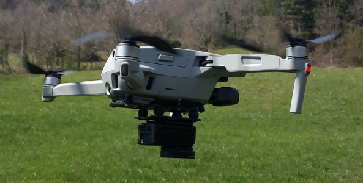

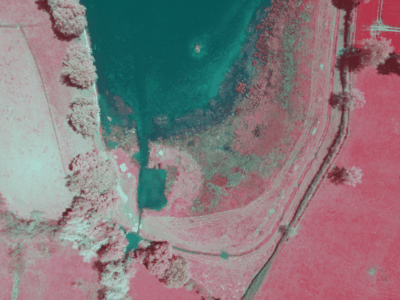


# General information
* 🚀 Current version: 1.4
* ⌨️ Authors : Balthazar Neveu , Alain Neveu
* 🕹️ Testers: [Pépin Hugonnot](https://www.pepin-hugonnot.fr/vincent-hugonnot-florine-pepin-auvergne_fr.html) : Florine Pépin 

## Main features
* two kinds of missions, chosen when the mission is created: **multispectral** (drone + infrared camera,
  everything below) or **visible only** (drone DNG only: no synchronisation, the images are developed
  and mapped in colour)
* preprocess
  * synchronize the RGB DJI camera with the NIR camera using a "QR code"
  * best synchronized pairs: find the images pairs with lowest delay
* process
  * convert RAW files to linear RGB files
  * align NIR images with the visible RGB images
* postprocess for cartography
  * prepare tiles to be stitched in [OpenDroneMap](https://OpenDroneMap.org) 
  * and later visualize under [QGIS](https://www.qgis.org) with overlay on top of Google maps / IGN maps for instance.


------------
# 🔋 Set up

------------
IRDrone runs on **Windows and Linux** (both tested on every change, Python 3.9 and 3.12) and on macOS.
It needs a Python environment with the packages of [requirements.txt](./requirements.txt), and a few external tools.

## 1. Get the code
```bash
git clone https://github.com/wisescootering/infrareddrone.git
cd infrareddrone
```

## 2. Python environment
The setup scripts create a virtual environment `.venv` at the repository root.
They use [uv](https://docs.astral.sh/uv/) when it is installed (recommended: fast, and it downloads
the right Python by itself), otherwise `python -m venv` + pip.

| | Command |
|---|---|
| 🐧 Linux / 🍎 macOS | `./setup.sh` |
| 🪟 Windows | double-click [`bat_helpers/install.bat`](./bat_helpers/install.bat) |

* Python 3.12 by default, `IRDRONE_PYTHON_VERSION` to pick another one (3.9 or newer).
* Run the script again to update the environment. `./setup.sh --recreate` (or deleting `.venv`) starts from scratch.
* Without uv on Debian / Ubuntu, `python3-venv` and `python3-tk` are needed: `sudo apt install python3-venv python3-tk`.
* At the end, the scripts check the packages and tell which external tools are missing.

Doing the same by hand:
```bash
uv venv --python 3.12 .venv
uv pip install -r requirements.txt
```

*Conda works too if you prefer it*: `conda env create -f environment.yml` creates the `irdrone`
environment ([environment.yml](./environment.yml): Python and GDAL from conda-forge, the rest from `requirements.txt`).
GDAL is optional: it draws the contour lines of the maps, which are skipped without it.
The launchers find this environment automatically, see below.

## 3. External tools
| Tool | Needed for | Windows | Linux (Debian / Ubuntu) | macOS |
|---|---|---|---|---|
| [ExifTool](https://exiftool.org) | always | bundled in `thirdparty/` | `sudo apt install libimage-exiftool-perl` | `brew install exiftool` |
| [RawTherapee](https://www.rawtherapee.com) | DJI DNG images | installer, default location | `sudo apt install rawtherapee` | [RawTherapee.app](https://www.rawtherapee.com/downloads) in `/Applications` |
| [SJCam RAW converter](https://github.com/yanburman/sjcam_raw2dng) | SJCam .RAW images | bundled in `thirdparty/` | bundled (x86-64) | build it from source |
| [Docker](https://www.docker.com/) | OpenDroneMap maps (step 6) | Docker Desktop | `docker.io` or Docker Engine | Docker Desktop |

Each tool is looked up in its environment variable (`EXIFTOOLPATH`, `RAWTHERAPEEPATH`, `SJCONVERTERPATH`),
then at its usual location, then on the `PATH`.

## 4. Sample data
Download our sample flight [FLY_TEST](https://drive.google.com/drive/folders/1khi0WdWyZ6H7Z7Lc5Q_i-Mm0Xq2sgpd1?usp=sharing).

## 🧙 Launch the IRDrone wizard (GUI)
* Windows: double-click `irdrone_wizard.bat`
* Linux / macOS: `./irdrone_wizard.sh`

Both launchers use the first Python found among: the `IRDRONE_PYTHON` environment variable,
the `.venv` folder at the repository root, the conda environment `irdrone` (or the former `py39_clean`)
in `~/miniforge3`, `~/miniconda3` or `~/anaconda3` (another name: set `IRDRONE_CONDA_ENV`),
then the Python on the PATH. The wizard code lives in [irdrone_wizard](./irdrone_wizard).

At the first launch the wizard asks for the working folder where missions are stored
(default `C:/Air-Mission` on Windows, `~/Air-Mission` elsewhere). It is shown at the bottom of
the main window, with a ⚙ button to change it, and saved in the user settings
(`%APPDATA%\IRDrone\settings.json`, `~/.config/irdrone/settings.json` on Linux).
The environment variable `IRDRONE_WORKING_DIR`, when set, takes priority.

## ⌨️ Command line
With the environment activated (`source .venv/bin/activate`, or `.venv\Scripts\activate` on Windows):
```bash
python synchronization/synchro_by_aruco.py --folder FLY_test/Synchro/ --vis "*.DNG" --nir "*.RAW"
python run.py --config FLY_test/config.json --clean-proxy --odm-multispectral --selection best-mapping
python automatic_registration.py --images VISIBLE.DNG INFRARED.RAW --outdir aligned/  # a single pair
python run_after_preprocessing.py -i FLY_test --visible-only  # visible only mission: develop the DNG (implied by the mission type)
```
All the `run.py` options are described in *Details* below. `tests/cli_smoke.sh` checks these tools on the sample pair of `samples/`.


## 🧪 Tests
```bash
uv pip install -r requirements-dev.txt   # pytest
python -m pytest                         # unit tests (tests/), headless
uvx ruff@0.17.1 check .                  # lint
tests/cli_smoke.sh                       # command line tools on the sample pair (needs RawTherapee, ExifTool)
```
They also run on every pull request (Linux and Windows, Python 3.9 and 3.12), together with the Docker image.


------------
## 🐋 Docker

------------
The image contains the command line tools (no GUI) with RawTherapee and ExifTool, on any OS running [Docker](https://www.docker.com/).
```bash
docker build -t irdrone .
docker run --rm -it -v /path/to/FLY_test:/home/samples/FLY_test irdrone
```
Then, inside the container:
```bash
python synchronization/synchro_by_aruco.py --folder /home/samples/FLY_test/Synchro/ --vis "*.DNG" --nir "*.RAW"
python run.py --config /home/samples/FLY_test/config.json --clean-proxy --odm-multispectral --selection best-mapping
```

Notes:
 * *on Windows, the volume looks like `-v C:\Users\xxxx\Documents\FLY_test:/home/samples/FLY_test`*
 * *press CTRL+D to leave the container*
 * *there are no visual checks through graphs*
 * *OpenDroneMap is not included: run it from the host on the exported images*


------------
## 🔨 Hardware
------------
* Drone visible camera (DJI Mavic Air 2) is used to shoots RAW images
* An action camera with a wide FOV (SJCAM M20)
  * IR cut filter has been removed is attached under the drone
  * a dedicated IR band filter has been installed (which cuts visible light and only transmits IR - use 750nm or 850nm filters).
* 🏁 QR code (*Aruco*) chart can be downloaded [here](https://drive.google.com/file/d/1rMB6LjY2Mi3gQDq5Mr6PrtMRRrahtkRC/view?usp=sharing) and has to be printed to A4 or A3 paper for calibration matters.

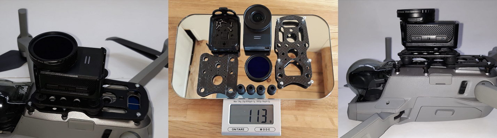


------------
# 🎓 Tutorial
------------

* Fly
* Process images

------------
## ✈️  Flying *tutorial*
------------
* Trigger the 3s interval timelapse on the SJCam action cam
* Start flying your drone.
* Start the 2s interval timelapse on the DJI app
* ⏳ Before flying a temporal synchronization procedure has to be performed to sync the 2 cameras clocks.
* It consists in making the drone stay in a stationary position while a QR code spins below. [full sync procedure doc](https://docs.google.com/presentation/d/1h4Z3gMXSZpbntx-dJ7GK4vR63rED0lpN/edit?usp=sharing&ouid=107424034863786906577&rtpof=true&sd=true) 

*Note: spinning the drone above the QR code (Aruco) chart is also possible, it does not require a turntable but it's less recommended*

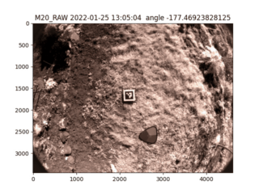 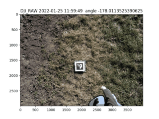

* 📷 Then the **mandatory way** to capture your data is to fly straight away 
  * ⚠️ **without stopping the timelapse** ⚠️
  * Keep both cameras shooting in timelapse modes. 
  * Try to cover your area in a grid fashion (fly straight forwerd, pan to the right or left, fly straight backward etc...)


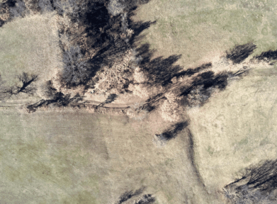 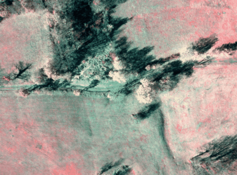

------------

# ⚠️ REMINDER ⚠️

* ✔️ Synchronization phase is key
* ⛔ **Do not stop** the timelapse ⛔  after the synchro phase!
* ✔️ keep on flying with the same DJI timelapse on until the end of the fly

-------------


## ▶️ Image processing *tutorial*
* 0/ ⭐⭐⭐ Download our sample folder [📁 FLY_TEST  ](https://drive.google.com/drive/folders/1khi0WdWyZ6H7Z7Lc5Q_i-Mm0Xq2sgpd1?usp=sharing) 
* 1/ 💾 Once finished, offload your SD cards from IR & Visible cameras into folders following the architecture below (refer to the sample example FLY_TEST)
  * 📁`FLY_DATE`
    * 📁`AerialPhotography` *folder where you put all pictures from the flight phase*
    * 📁`Synchro` folder where you put all picture from the synchronization phase
    * 📝 `config.json`
* 2/ ❓ Configuration file can be changed (modify json or excel). *folder names can be changed for instance, if you're interested looking at the "Configuration" section*.
* 3/ ⏰ Double click on [`bat_helpers/synchro.bat`](/bat_helpers/synchro.bat) and select the 📁 `Synchro` folder. 
  * This will open a graph, please make sure that the black and orange curves overlap correctly. Then you can close the graph.
  * *This will generate a `syncho.npy` binary file  in the `Synchro` folder ... which you will re-use as a configuration parameter. Don't worry, if you re-use the sample example configuration and folder naming, you won't have to change anything.*

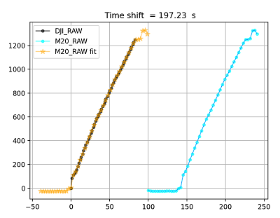


* 4/ ⏯️ Now you're ready to process your images. Double click on [`bat_helpers/run.bat`](/bat_helpers/run.bat) and select the configuration `config.json` file. 
*Note .json or .xlsx will do the same.*
* 5/ 📈 Check the altitude profile displayed (internet connection is needed here).

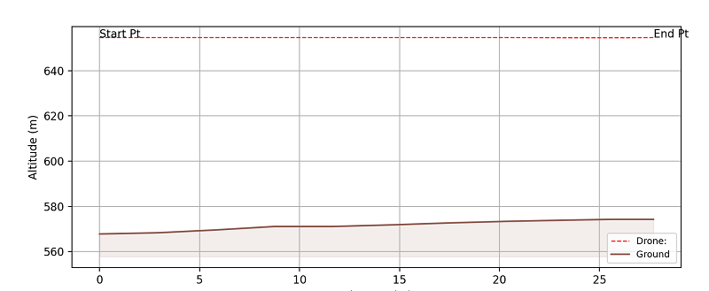
* 6/ 💤 Confirm you want to run processing on your images. Then be very patient, your files will be processed and stored in the 📁 `ImgIRdrone` folder.

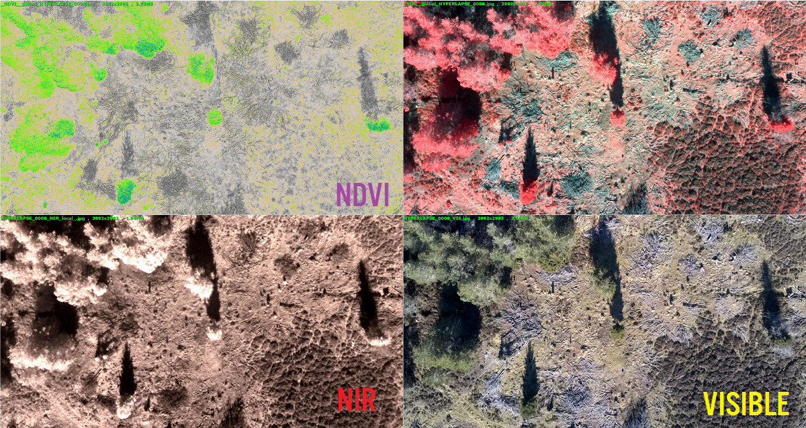


❌ Keep in mind that things are not perfect and there can sometimes be failures. If there's a picture which is very important, you are encouraged to re-run the processing with a manual option to assist the alignment (*next to the processed image, you can find a .bat dedicated to reprocessing your image with manual assistance : example `HYPERLAPSE_0008_REDO.bat`*). 
* On the left, you can see that the red image has to be shifted to the left side to match the blue image. 
* Use the yaw slider to align blue and green, see what happens on the right side? the overlap is correct!
* then press `Q` to quit the GUI
* process will continue the automatic processing. You have helped the initialization manually that way.

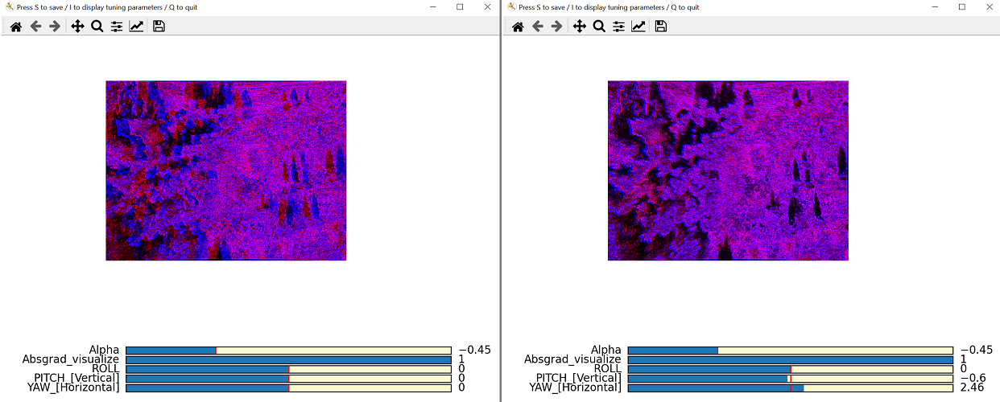


### 🗺️ Third party maps software
Original metadata from the DJI drone are copied into the output file therefore these images are ready to be re-used in thirdparty software. 
We'll prepare tiles to be stitched in [OpenDroneMap](https://OpenDroneMap.org) and later allow you to visualize under [QGIS](https://www.qgis.org) with access to maps.


#### 🗺️OpenDroneMap
You'll need to have 🐋 Docker running to be able to stitch maps using OpenDroneMaps.  
* Next to `ImgIRdrone` folder, you can find a folder named `mapping_MULTI` . 
* inside this folder, we have prepared everything you need to run the ODM stitching:
  * images with correct overlap and correct exif
  * camera calibration
  * `odm_mapping.bat` allows you to run the right docker with the right options.
* Once the process has finished, you'll find a png with the stitched maps. `mapping_XXX/odm_orthophoto/odm_orthophoto.png`

*Note: In case you didn't use `--odm-multispectral` option in run.py you'll get a folder for each spectral modality (visible, nir, ndvi, vir)*


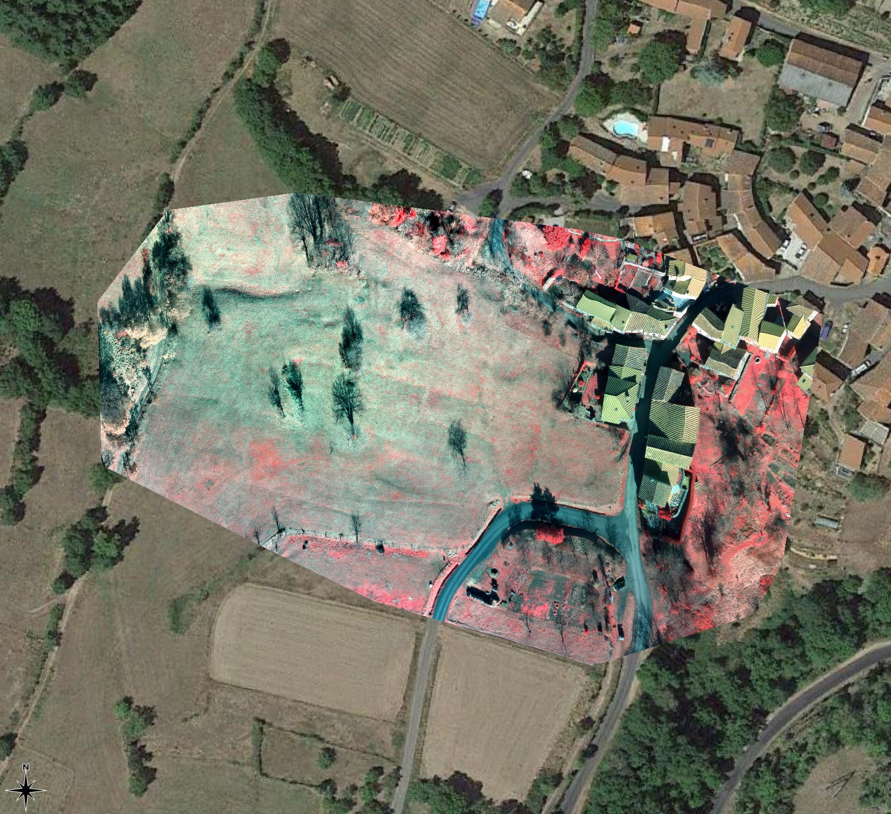

#### 🗺️QGIS
Once stitched with ODM, you can visualize the map in QGIS and start annotating your map.

Please refer to the following tutorial (in french) on how to create [vegetation visualization under QGIS](https://github.com/wisescootering/infrareddrone/files/9795223/QGIS_multispectral_maps_creation.pdf).

#### 💲 Pix4DFields

*For instance, creating a map is possible in Pix4DField in case you own a license (I used the Trial version which is available for 15days)*

* When launching Pix4DFields, the DJI camera won't be supported by default. You need to import a [custom camera file](https://support.pix4d.com/hc/en-us/articles/360035481811-What-to-do-when-a-camera-is-not-supported-in-Pix4Dfields).
* Luckily, we created one for the DJI Mavic Air 2, see [Pix4DFields_custom_camera](/thirdparty/Pix4DFields_custom_camera)


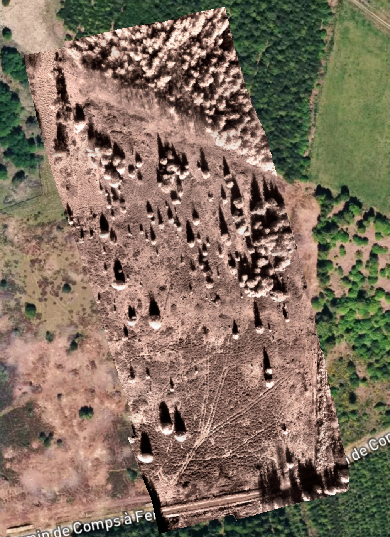

------------
# 🆘 Details
------------

---------------------------------------
## ⚙️ [`run.py`](./run.py) command line interface

---------------------------------------
`run.py [--config CONFIG] [--clean-proxy] [--odm-multispectral] [--traces {vis,nir,vir,ndvi}] [--selection {all,best-synchro,best-mapping}] [--workers WORKERS]`


- `--config` *path to the flight configuration*
- `--clean-proxy`   *clean proxy tif files to save storage*
- `--disable-altitude-api` *force not using altitude from IGN API*
- `--odm-multispectral`   *ODM multispectral .tif exports* 
- `--traces {vis,nir,vir,ndvi}` *export specific spectral traces. when not provided: VIR by default if `--odm-multispectral`, otherwise all traces are saved*
- `--selection` {all,best-synchro,best-mapping} 
  - `all`: take all images, do not make a specific image selection
  - `best-synchro`: only pick pairs of images with gap < 1/4th of the TimeLapseDJI interval ~ 0.5 seconds
  - `best-mapping`: select best synchronized images + granting a decent overlap
- `--workers` *number of alignment worker processes. `0` (default) picks it from the physical cores and the available RAM (about 3 GB per worker); `1` is the safe sequential mode*

---------------------------------------
## ⚙️ Configuration files

---------------------------------------

❓ At step 2/ of the tutorial, you have probably copy pasted the config.json from the sample folder. Here are some details on how configuration works.

⚙️ Create configuration file from the template ( **.xlsx** for beginers or **.json** for advanced users)
  * based on excel on the provided template [Templates/config.xlsx](./Templates/config.xlsx), fill mandatory information in green and red.
  * another option is to create a json configuration from the following template [Templates/config.json](./Templates/config.json). 

If you want to change the configuration, you have 2 options 
### JSON configuration approach

```
{
  "synchro":"Synchro/synchro.npy",
  "output": "ImgIRdrone",
  "visible": "AerialPhotography/*.DNG",
  "nir": "AerialPhotography/*.RAW",
  "visible_timelapse": 2.0,
  "nir_timelapse": 3.0
}
```
* **`synchro` field  links to the synchronization file obtained when running `bat_helpers/synchro.bat` previously**
* You can change the `output` folder here. 
* glob regexp use are suggested in `visible` or `nir` keys to search the images. *Please not that this way you can use 2 different folders for NIR and visible images.*
* OPTIONAL : 
  * If you roughly know the angles between the drone & the NIR camera, you can mention the `offset_angles` key `[Yaw, Pitch,Roll]`.
  * Usually at the end of your processing, you'll see if the estimated angles differ from the gimbal estimate (retrieved from EXIF).
  * Example: "offset_angles": [0.86, 1.43, 0.0]

### Excel configuration approach
🚫 EXCEL CONFIG IS NOT SUGGESTED  / DEPRECATED 🚫
* You can simply put the relative path to `synchro.npy` and you should be good to go

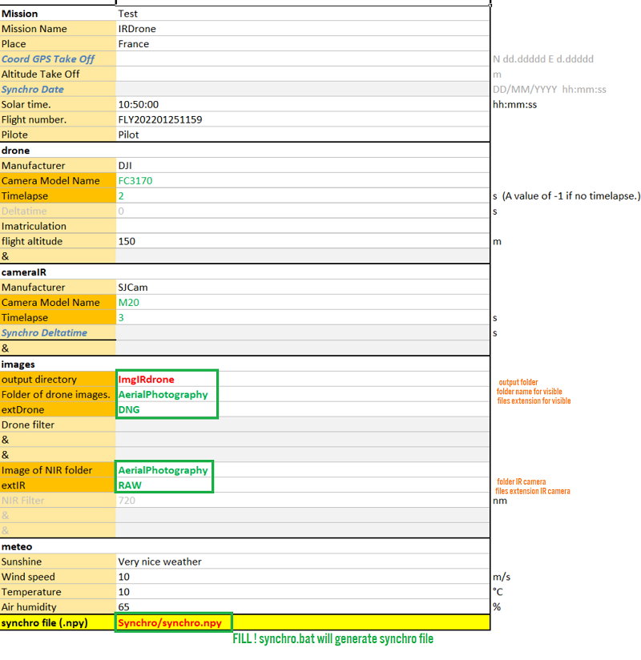


### Link with synchro.bat is made automatically 
* Double click on [`bat_helpers/synchro.bat](/bat_helpers/synchro.bat). *(Advanced users can use CLI obviously in case of other images format)* 
* Unless you want to do manual manipulations, do not paste the delay result to your configuration excel in  `cameraIR` / `deltatime` . You can simply close the window, the program saved a synchro.npy file in the Synchro folder!


### Manual fallback : forcing parameters
* Mastering the config.json:
  * *optional: You can use the `input` key (or `rootdir`) to provide a direct link to a specific folder (that would allow you to store all configurations at a unique place... including keeping your projects configurations under git revision).*
  * optional fields in config.json, these fields exist to override synchronization parameters coming from synchro.npy
    * `synchro_deltatime`
    * `synchro_date`
    * `coord_GPS_take_off` 
* In the excel template, there are some fields marked in blue where you can also override the values from synchro.npy

for instance, you have to copy/paste into the excel 
  * `3894.74`  = delta time.
  * `25/01/2022 11:59:49` = date
  * `N 45.16954 E 3.40005` = Coord GPS Take Off


## Synchronization software
* Aruco (=QR code) chart can be downloaded [here](https://drive.google.com/file/d/1rMB6LjY2Mi3gQDq5Mr6PrtMRRrahtkRC/view?usp=sharing) and has to be printed to A4 or A3 paper

* Several procedures were tested:
  * Spinning the chart under the static drone **!RECOMMENDED!**
    * [full procedure here](https://docs.google.com/presentation/d/1h4Z3gMXSZpbntx-dJ7GK4vR63rED0lpN/edit?usp=sharing&ouid=107424034863786906577&rtpof=true&sd=true)
    * [arduino code for the spinning table](https://drive.google.com/file/d/1ECo0p3RrOPgs_Xkl1UeffkmGnplZRWYM/view?usp=sharing)
  * Rotating the drone above the static chart: *more complicated to manipulate, not recommended* [description](https://drive.google.com/drive/folders/1Uk-eWBwteD2reOCdT0kngCWgcddz4C5s?usp=sharing) is available here.
* Sample synchro data can be downloaded from [here](https://drive.google.com/drive/folders/10SCdV_wb57L6ODKlqpWORkE1B0559aUL?usp=sharing) 
* Copy the selected synchronization images into a "Synchro" folder -> visible & NIR images (expected .RAW and .DNG files by default).
* Double click on [bat_helpers/synchro.bat](/bat_helpers/synchro.bat). *(Advanced users can use CLI obviously in case of other images format)


## Alignment and Fusion
* Data can be processed by double cliking on [`bat_helpers/run.bat`](/bat_helpers/run.bat). This will use [`run.py`](./run.py) to select a given config.json or excel file.
* Advanced users can also use CLI (command line interface) to process the batch of images. Use `--config` option to 
* CLI users can register pairs of images [automatic_registration.py](automatic_registration.py) 


---------------------------
# 🤓 Technical details 

---------------------------


# Details on processing
## Data processing description
## Pre-processing
  * SJCam M20 .RAW files are first converted to DNG using the following program [sjcam_raw2dng](https://github.com/yanburman/sjcam_raw2dng)
  * SJCAM .DNG & DJI .DNG files are processed using Raw Therapee to **linear demosaicked RGB 16bits** TIF files.
  * Lens Shading is automatically corrected while loading the TIF files.
## Alignment
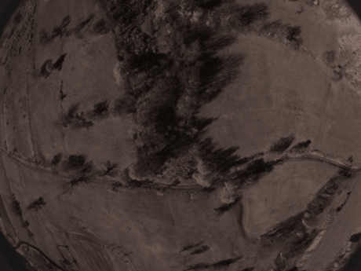

* We first undistort the DJI visible image and undisort the infrared fisheye. In case of wind, the misalignment between both cameras can be of up to 20°s. 
  Roll of the drone leads to camera yaw, Pitch of the drone leads to camera pitch. Camera roll misalignment is usually zero because of the gimbal lock when the camera points towards the ground. 
  Hopefully, the fisheye has a much wider field of view than the DJI visible camera, therefore we're able to align the NIR image onto the visible image.
* Alignment is first performed by a "coarse alignment" to compensate coarsely camera misalignment yaw (well approximated by an horizontal translation)
  and camera misalignment pitch (well approximated by a vertical translation). 
  * We first undistort the SJcam NIR fisheye and match magnification factor with the DJI camera.
    The virtual NIR undistorted camera has the same focal length as the DJI camera but a much wider field of view. 
    If there's no misalignment, the center window of the SJcam image shall overlap the visible image
  * The first step of the coarse search is performed at very low resolution first
    * with a brute force approach (searching for the X Y tranlation which minimizes a certain cost function between the visible image and a moving window in the NIR image)
    * The translation approximates the underlying yaw/pitch camera rotation which we can simply recover. It allows to warp the NIR image onto a finer scale.
* Alignment refinement is then performed on the coarsely aligned NIR image. 
  * A pyramidal approach is chosen.
  * At each level of the pyramid, we estimate a vector field of displacements (split the images into 5x5 patches for instance and search for the best displacement)
  * This local vector field is sort of regularized by a global motion model fit (homography) which allows to refine the yaw, pitch & roll angles.
  * When going to  a finer scale, we warp the image according to the global homography estimated at the previous level. This allows to reduce the search horizon.
  
## Post-processing
* Once the alignment model has been found, the NIR image is warped (only once) on the Visible image.
* Several color representation of the merge of NIR & Visible images can be computed such as NDVI or VIR.
* **Important note : color calibration shall be tackled at some point**, it may not be too difficult though.


  
## Semi-automatic fallback
While reviewing the data, there may still be some issues in alignment.
Unfortunately multispectral alignment is an ill-posed problem and sometimes the automatic system fails.
There's still a way to save your images.
  * In the wizard (Step 5, review): flag the misaligned points, then *Realign N flagged by hand*. A window takes every
    flagged point in turn: drag the infrared over the visible image (right mouse button, arrow keys, or *Fit*),
    then the alignments of all the points are computed together in the background and you confirm each result.
  * From the command line: there's a .bat file (.sh on Linux / macOS) next to the results which allows you to re-run manually the images which failed. 
  * It will open a GUI where you can simply pick the yaw, pitch & roll
    to replace the coarse alignment & make the images overlap. 
    This will guide the automatic system to a manual initial guess which will eventually lead to an accurate automatic alignment.
  * If synchronization does not seem correct (or there was big wind), you can try your luck with another image by uncommenting the right line in the .bat .


-------------------------
# 🌎 Exploiting data in third-party software
-------------------------
* Putting these data in [Pix4DFields](https://www.pix4d.com/product/pix4dfields) is possible
* Putting a timelapse into a panorama stitching software like [Hugin](http://hugin.sourceforge.net/) allows to stictch these images.
* Putting a timelapse into [VisualSFM](http://ccwu.me/vsfm/) allows to create a 3D map out of these images 
  just like you'd do with your drone images

-------------------------
# ✍🏻 Scientific references
* Normalized Total Gradient: A New Measure for Multispectral Image Registration *Shu-Jie Chen and Hui-Liang* [Paper](https://arxiv.org/pdf/1702.04562.pdf)
* Robust multi-sensor image alignment, *Michal Irani and P Anandan at ICCV'98* [Paper](http://www.weizmann.ac.il/math/irani/sites/math.irani/files/publications/multisensoralignment.pdf)
* Burst photography for high dynamic range and low-light imaging on mobile cameras, *Samuel W. Hasinoff, Dillon Sharlet, Ryan Geiss, Andrew Adams, Jonathan T. Barron, Florian Kainz, Jiawen Chen, and Marc Levoy*,  [Supplemental Material](https://static.googleusercontent.com/media/hdrplusdata.org/fr//hdrplus_supp.pdf)
* Registration of visible and near infrared unmanned aerial vehicle images based on Fourier-Mellin transform *Gilles Rabatel, S. Labbe* [Paper](https://hal.archives-ouvertes.fr/hal-01684135/document)
* Two-step multi-spectral registration via key-point detector and gradient similarity. Application to agronomic scenes for proxy-sensing *Jehan-Antoine Vayssade, Gawain Jones, Jean-Noël Paoli, Christelle Gée* [paper](https://hal-agrosup-dijon.archives-ouvertes.fr/hal-02499730)


## 📎 Technical notes
* Please note that feature based method did not work correctly and generally speaking. Using Phase correlation/Fourier (including Melin Fourier) didn't bring fully satisfying results either for the coarse approach.
* The Normalized Total Gradient was retained as a cost function. Motion regularization is not implemented here and some form of regularization shall be implemented for the local estimation in the near future.


-------------------------
# 🎮 CODE STUFF - Image processing and visualization features
-------------------------
With this project comes a few useful tool, especially the interactive image processing GUI which makes complex pipelines easily tunable.


## 🧱 Image processing pipeline

[interactive.imagepipe.Imagepipe](interactive/imagepipe.py) class is designed to build a simple image processing pipeline with interactive sliders. If you're interested, refer to the [documentation](/interactive/readme.md)


----------------------------------
# 📏 Camera calibration
* Officially supported cameras (camera calibrations are pre-stored in the calibration/mycamera folder)
  * DJI RAW
  * SJcam M20 RAW

Refer to the calibration documents 
[Details on calibration procedure](/calibration/readme.md) & extra [ documents](https://drive.google.com/drive/folders/1wm4mNICmo9koOwB6QRJn871etPJu7mk0?usp=sharing)


-------------------------
# 📜 Release note
-------------------------
## v1.0 
* March 9, 2022
* First version based on standalone run.bat based on excel configuration
* install.bat to setup the environment on windows
* processing engin

## [v1.1](https://github.com/wisescootering/infrareddrone/milestone/1)
* March 18, 2022
* Use config.json or excel ([#1](https://github.com/wisescootering/infrareddrone/issues/1))
* Crop outputs with a few pixels to avoid black/red borders ([#2](https://github.com/wisescootering/infrareddrone/issues/2))
* configuration re-uses synchro.npy (pickle) so there are is no need to copy paste values from synchronization phase. ([#3](https://github.com/wisescootering/infrareddrone/issues/3))


## [v1.2](https://github.com/wisescootering/infrareddrone/milestone/1)
* August 28, 2022
* Docker support (linux or basically any platform)
* Feature #10 Output data compatibility with OpenDroneMap (document, bat helpers to run ODM)
* Remove intermediate TIF to save storage using `--clean-proxy` option.
* Bugs fixed: #19 #20 features #10 #16 #13 #12


## [v1.3](https://github.com/wisescootering/infrareddrone/milestone/3)
* October 21, 2022
* Multispectral TIF support for ODM ([#25](https://github.com/wisescootering/infrareddrone/issues/25)) 
* Possibility to visualize VIR jpg (or other by using the `--trace` argument) still allowing the redo.bat manual to reprocess & generate the multispectral tif ([#30](https://github.com/wisescootering/infrareddrone/issues/30))
* Reduce computation by selecting less frames for processing: `--selection` option in `run.py` supports `best-synchro` & `best-mapping` & `all` ([#29](https://github.com/wisescootering/infrareddrone/issues/29))
* Possibility to run alignment on pairs using file dialog ([#21](https://github.com/wisescootering/infrareddrone/issues/21))
* Issues closed: [#14](https://github.com/wisescootering/infrareddrone/issues/14) [#18](https://github.com/wisescootering/infrareddrone/issues/18) [#22](https://github.com/wisescootering/infrareddrone/issues/22) [#26](https://github.com/wisescootering/infrareddrone/issues/26)


## v1.4
* November 2026
* 🧙 **IRDrone wizard**: a step-by-step PyQt6 application ([irdrone_wizard](./irdrone_wizard)) covering the whole workflow,
  from mission creation to georeferenced maps, with a user manual (help/irdrone_help.pdf)
  * Step 1-2: mission creation (altitude, distance, heading), take-off image, VIS / NIR image loading
  * Step 3: VIS / NIR time synchronization from the ArUco target, with a slider to adjust the time shift by hand
  * Step 4: parallel alignment (worker count sized by CPU and RAM, gear settings dialog), redo of misaligned points from VIR / NDVI / NIR images
  * Step 5 review: realign by hand every flagged point first (Qt window: overlay / swipe / blink, drag or arrow keys,
    automatic fit), then their alignments run together in the background, then confirm each result
  * Step 6: OpenDroneMap mapping, orthorectification of single images (DJI raw and multispectral), error map, DTM and contour lines (topographic map)
  * Step 7: mission archive
  * Launchers at the root: `irdrone_wizard.bat` (Windows) and `irdrone_wizard.sh` (Linux / macOS)
* 4-channel multispectral TIF with an EXIF sidecar file
* Linux support: `setup.sh` (uv or pip virtual environment), Docker context fallback for ODM, shell recovery scripts, case-insensitive image extensions
* `run.py` and `run_after_preprocessing.py`: `--workers` option for parallel alignment, `--log-level`
* 🗺️ **Best mapping in the wizard**: keep only the images the map needs (ground footprint overlap, 75 % by default),
  previewed live in Step 2 on the time line and on a flight map, applied in Step 4 to the well synchronised pairs
  (far less to align; best mapping / all images, with a live map) and in Step 6 to the ODM images; the main window map
  shows the sparse trajectory of the images kept; `run_after_preprocessing.py --best-mapping-overlap 75`
* Compatibility with recent libraries: OpenCV 4.7+ / 5.x ArUco API, SciPy 1.14+ (interp2d removed), scikit-image pyramids; GDAL is now optional
* Fixes: black orthophoto preview after ODM (broken JPEG overviews on 16-bit data), angle interpolation across 360°, Windows tool paths, DJI RawTherapee profile


